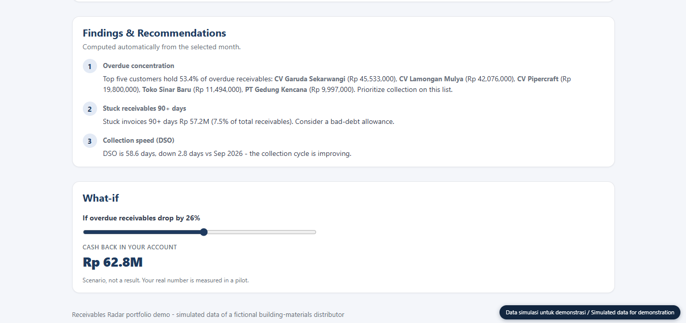
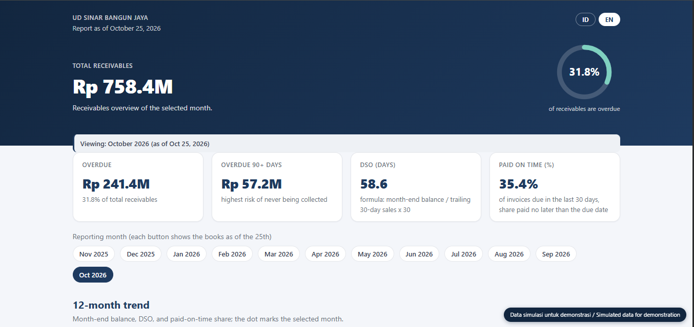
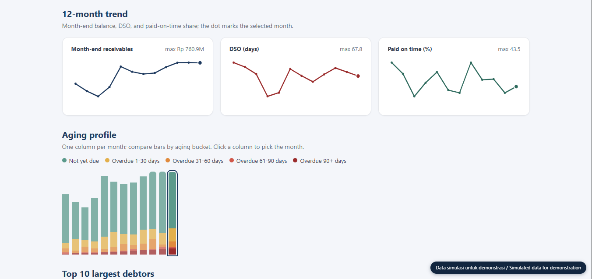
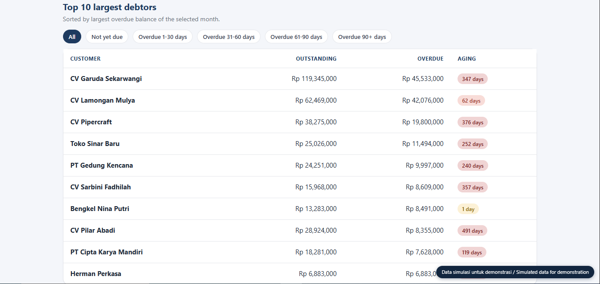

# Receivables Radar

> A dashboard and collection tool for businesses that sell on credit. It shows which overdue invoices to chase first.

**[Live demo](https://sri-setiowati.github.io/receivables-radar/)** · **[Chat with me on WhatsApp](https://wa.me/62XXXXXXXXXXX?text=Hi%20Sri%2C%20I%20saw%20your%20Receivables%20Radar%20demo%20and%20I%27d%20like%20to%20try%20it%20on%20my%20invoices.)**

In the simulated demo data, 79 invoices fell due in the last 30 days and only 28 were paid on time. The useful question is which customers to call first.

I ran a building-materials store for 17 years, so I have chased my share of late invoices. Deciding who to call first was harder than the calls themselves, especially when ten customers owed money and I had one afternoon.

## What it does

- Reads an invoice export from a spreadsheet, including messy dates and amounts
- Groups receivables by age: not yet due, 1-30, 31-60, 61-90 and 90+ days overdue
- Ranks customers by how much they owe and how late they are
- Calculates days sales outstanding (DSO) and the share of invoices paid on time
- Writes three findings from the data, for example how much of the overdue balance sits with the top five customers
- Drafts a WhatsApp reminder for each customer

## Free pilot for businesses that sell on credit

I am looking for two or three businesses willing to run Receivables Radar on a real invoice file. The pilot is free. In return, I ask to use the results as a case study, and your company name can stay anonymous.

**What you get within 2 to 3 days**

- An aging report of every open invoice
- The 10 customers to chase first, ranked by amount and delay
- Three findings in plain business language
- A draft WhatsApp message for each customer

**What I need from you.** An export of your invoices from Excel, your accounting software or your POS. The format does not matter much, I will adapt to it. Before you send anything, we agree in writing on how your file is handled and when it is deleted.

**How we measure it.** Before we start, I record your overdue balance, your DSO and the share of invoices paid on time. After six weeks of collecting with the weekly lists, I measure the same three again. You see the numbers, including the ones that did not improve.

**What it could be worth.** If your overdue balance is Rp 240 million, every 10% reduction puts about Rp 24 million back in your account. That is a scenario, not a promise. The pilot measures your real number.

If you want to continue after the pilot, we agree on a fixed price before any work starts.

**[Start on WhatsApp](https://wa.me/62XXXXXXXXXXX?text=Hi%20Sri%2C%20I%20saw%20your%20Receivables%20Radar%20demo%20and%20I%27d%20like%20to%20try%20it%20on%20my%20invoices.)**

## About the demo

The data is simulated: a fictional building-materials distributor with 12 months of invoices. Nothing in it comes from a real company. The page is available in English and Indonesian.

The month buttons at the top are 12 snapshots, one per month. Each shows the books as of the 25th. Click a month and every number on the page changes to match.

The live demo shows the dashboard only. The full tool also reads invoice files, ranks customers and drafts the WhatsApp messages. It runs locally, and its source code is not published in this repository.

## Built with

| Part | Tool |
| :--- | :--- |
| Data processing and tests | Python, 80 automated tests |
| Dashboard | Plain HTML and JavaScript, one file, works offline |
| Browser checks | Headless Chromium via Playwright |

## More of my work

- [Olist e-commerce analysis](https://github.com/sri-setiowati/olist-ecommerce-analysis)
- [Marketing campaign ROI analysis](https://github.com/sri-setiowati/marketing-campaign-roi-analysis)

## Contact

Sri Setiowati, Sidoarjo, Indonesia

[WhatsApp](https://wa.me/6285932888258) · [LinkedIn](https://linkedin.com/in/sri-setiowati) · [GitHub](https://github.com/sri-setiowati)
